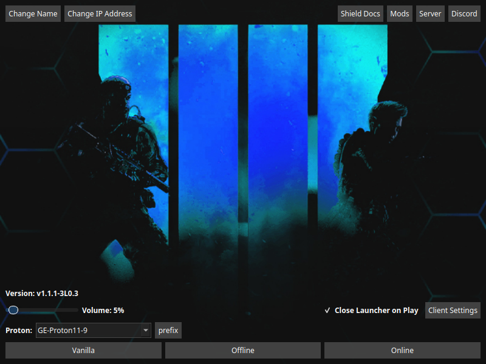
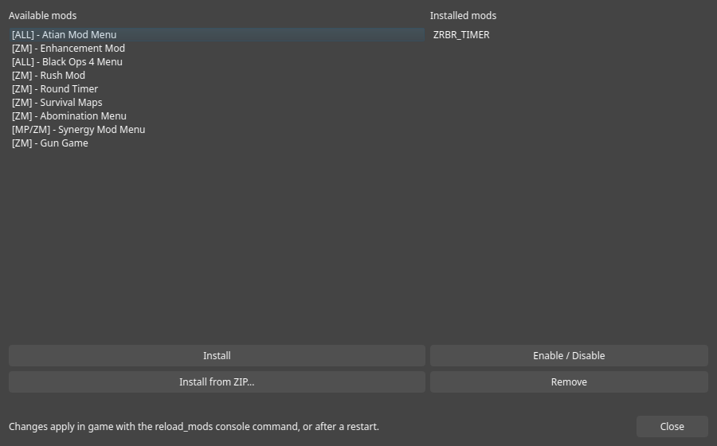
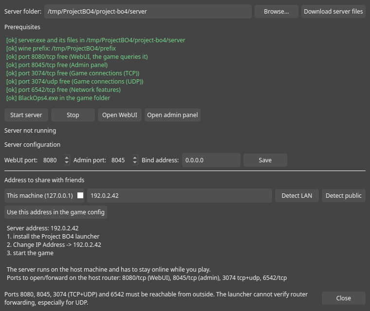

# Project BO4 launcher, Windows and Linux

Launcher for the [Shield](https://shield-client.gitbook.io/shield-documentation)
Project BO4 client. One source tree, two platforms: the same binary that runs
natively on Windows starts the game through Proton or Wine on Linux.

Release `v1.1.1-3L0.3` is the fork build: Linux support, a mod manager in the
launcher and a local server wizard.



## What it does

- **Offline / Online**, with the matching `XInput9_1_0.dll` put in place for you.
  No more unpacking `solo.zip` or `mp.zip` by hand before each session.
- **Support archives** (`solo.zip`, `mp.zip`, `exe.zip`) are extracted
  in-process with a CRC check, so it works on Linux and inside a Wine prefix
  where `powershell Expand-Archive` does not.
- **Linux launch**: picks a Proton or Wine build, remembers the prefix, sets
  `WINEDLLOVERRIDES` itself.
- **Mods**: install, enable, disable and remove mods from the launcher.
- **Server**: host a local demonware server and hand the address to friends.
- **Client settings**: name, server address, volume, close-on-play, ReShade.

## Installation

1. Download the archive for your platform:
   - **Windows**: `Project_BO4_Launcher_Windows.zip`
   - **Linux**: `Project_BO4_Launcher_Linux.tar.gz`
2. Extract it somewhere.
3. Drag what is inside the folder into your `Call of Duty Black Ops 4` directory
   (the one with `BlackOps4.exe`):
   - `Shield_Launcher.exe` on Windows (+ its Qt DLLs and `platforms/`), or
     `Shield_Launcher` on Linux, at the game root
   - the `project-bo4` folder next to it (resources the launcher loads)
4. Start `Shield_Launcher` and pick Offline or Online.

That is the whole install. The launcher finds its own resources, whichever of
the two classic layouts you end up with (game root or `project-bo4/launcher`).

### Linux in detail

The launcher lists the Proton and Wine builds it finds in Steam,
`compatibilitytools.d`, Heroic and umu, and a `Prefix...` button lets you pick
the wine prefix:

- a folder that already is a prefix (one holding Battle.net is proposed
  automatically) is used as is;
- an empty folder gets a prefix created in place.

`umu-run` is what starts the game, so any Proton build works, GE-Proton
included. Install [umu-launcher](https://github.com/Open-Wine-Components/umu-launcher)
and you are done.

## Mods



The in-game mod manager downloads through the game client, which does not work
under Wine: it reports success and `project-bo4/temp` stays empty. The launcher
does the same job outside the game, on both platforms.

- the curated list the in-game manager offers, plus `Install from ZIP...`
- a mod is a folder with a `metadata.json`; an archive without one is refused
  instead of half installed
- enable/disable moves the folder to `project-bo4/mods_disabled`
- files dropped directly in `project-bo4/mods` are listed as ignored, because
  the game does not load them

Changes apply in game with `reload_mods`, or after a restart.

## Server wizard



Hosts the demonware server published by
[mwhax7/wine-bo4-server](https://github.com/mwhax7/wine-bo4-server) without
Docker: `server.exe` runs natively on Windows and through the same Proton
runtime as the game on Linux.

- prerequisite checks: server files, wine prefix, and a **real** bind test on
  ports 8080, 8045, 3074 (TCP+UDP) and 6542 (`3074/udp` is red on the screenshot
  because the game was running)
- offers to download or repair the missing files
- edits `server-config.json` (web port, admin port, bind address)
- start / stop, with the WebUI polled for the live state
- picks the address to share (localhost, LAN, public, custom), writes it into
  `project-bo4.json` and prints an invite block with the ports to forward

Port forwarding itself cannot be automated: the ports have to be reachable from
outside, UDP included.

## Build

```sh
./build-linux.sh            # Linux release
./build-linux.sh debug      # Linux debug
# or by hand:
premake5 gmake              # Linux, system Qt6
premake5 vs2022             # Windows, MSVC, vendored Qt6 from deps/qt6
```

Linux needs a C++20 compiler, Qt6 base/widgets/network/multimedia development
packages, `premake5` and `umu-run`. Windows needs Visual Studio and the vendored
premake in `deps`.

CI builds both platforms on every push and publishes the two archives.

## Notes

- The launcher was not written by me: it is
  [NotNierPea/shield-launcher](https://github.com/NotNierPea/shield-launcher),
  which I maintain and improve. The Linux support, the mod manager and the
  server wizard were written with a Hermes agent (X.A.N.A, running on
  [Hermes Agent](https://hermes-agent.nousresearch.com/docs)) driving the work,
  reviewed and tested on real machines before release.
- The server files are never bundled: they are downloaded on demand from their
  repository, which ships no license.
- Help and troubleshooting: [discord](https://discord.gg/AXECAzJJGU).
